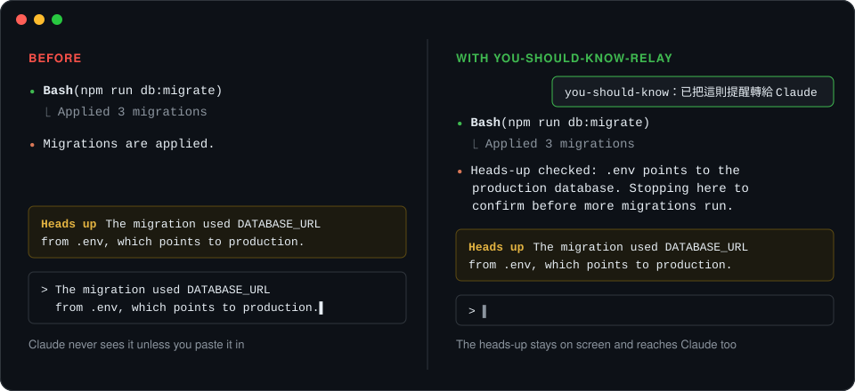

# you-should-know-relay

<p align="center">
  <strong>Claude hears the heads-up too.</strong><br>
  A Claude Code mod that forwards each heads-up from the built-in you-should-know plugin to Claude, so you no longer copy and paste it.
</p>

<p align="center">
  <a href="CHANGELOG.md"></a>
  <a href="LICENSE"></a>
  <a href="https://code.claude.com/docs"></a>
  <a href="hooks/register.ts"></a>
  <a href="hooks/register.test.ts"></a>
</p>

<p align="center">
  <a href="#how-it-works">How it works</a> ·
  <a href="#install">Install</a> ·
  <a href="#usage">Usage</a> ·
  <a href="#limitations">Limitations</a> ·
  <a href="#development">Development</a> ·
  <a href="CHANGELOG.md">Changelog</a>
</p>



*Illustration of a session before and after.*

Claude Code's built-in **you-should-know** plugin watches a session and, above the prompt, points out something Claude has not told you yet: a failing check, a file left staged, a decision with a cost. That heads-up is shown to you only. To make Claude act on it, you had to copy it into the prompt yourself. you-should-know-relay hands the same heads-up to Claude the moment it appears, while the heads-up stays on your screen as before.

> [!NOTE]
> This mod is built on Claude Code's early-access function-hooks API and reads how the built-in you-should-know plugin stores its heads-up, which is not a public interface. A Claude Code update may change either one. Built and tested against Claude Code **2.1.295**.

## How it works

| Step | What happens |
| --- | --- |
| 1. you-should-know shows a heads-up | Unchanged: it still appears above the prompt, with its own buttons. |
| 2. The mod picks it up | Only that plugin's heads-up for the current session, and each one once. |
| 3. Claude receives it | As a conversation note Claude reads, not as text you typed. |
| 4. You get a confirmation | A short toast: `you-should-know：已把這則提醒轉給 Claude`. |

**When Claude sees it:** during a running turn, at Claude's next step. After the turn has ended, together with your next message. The mod never starts a turn by itself.

The note tells Claude where the heads-up came from, quotes it, and asks Claude to address it in its next reply, or briefly say why it does not apply. The note, the toast and the command replies are written in Traditional Chinese.

## Install

In a Claude Code **terminal** session, run:

```
/plugin install you-should-know-relay --marketplace AnnihilationWizard/you-should-know-relay
```

1. Answer `y` to add the `github:AnnihilationWizard/you-should-know-relay` marketplace.
2. Choose a scope. The **user** scope loads the mod in every session.
3. Claude Code confirms `Installed you-should-know-relay. Plugin is now active.` No restart is needed.

To update later, run `claude plugin update`, then `/reload-plugins`.

<details>
<summary>Run from a local clone instead</summary>

```bash
git clone https://github.com/AnnihilationWizard/you-should-know-relay.git
claude --plugin-dir ./you-should-know-relay
```

To load a clone in every session, add it to the `env` block of `~/.claude/settings.json` (separate several folders with `:`):

```json
{
  "env": { "CLAUDE_CODE_PLUGIN_DIRS": "/path/to/you-should-know-relay" }
}
```

The setting is read when a session starts, so sessions already open need a restart.

</details>

## Usage

There is nothing to configure. Keep working, and each new heads-up reaches Claude on its own.

| Command | Effect |
| --- | --- |
| `/you-should-know-relay` | Pause forwarding. Heads-ups still show; Claude no longer receives them. |
| `/you-should-know-relay` again | Resume forwarding. |

| The pause | Behavior |
| --- | --- |
| Scope | One setting for every session, kept after Claude Code restarts. |
| Takes effect | Immediately, including in sessions that are already open. |
| Heads-ups shown while paused | Never sent later, even after you resume. |

## Limitations

- Every heads-up is forwarded, including ones you would mark as not relevant.
- The mod depends on the built-in you-should-know plugin. Where Claude Code does not run that plugin, the mod has nothing to forward.
- `/plugin install` is available in terminal sessions only.

## Development

```bash
claude plugin validate .   # manifest, marketplace file and hooks module
claude plugin test .       # hooks/*.test.ts against the engine
```

After Claude Code first loads the mod, it writes the API types to `.claude-plugin/types/` (git-ignored). Type-check against them with TypeScript 5.4 or newer:

```bash
npx -p typescript@5 tsc -p .
```

Run `claude --plugin-dir .` to try changes. In an interactive session the folder is watched, and saving a file reloads the mod.

## Project Structure

```text
.claude-plugin/   plugin.json manifest and marketplace.json
hooks/            hooks.json, the hooks module and its tests
types/            state contract for heads-ups already forwarded
docs/images/      README illustration
```

## Contributing

Bug reports and ideas are welcome. Read [CONTRIBUTING.md](CONTRIBUTING.md) before opening an [issue](https://github.com/AnnihilationWizard/you-should-know-relay/issues) or pull request, and follow [SECURITY.md](SECURITY.md) for security reports.

## License

[MIT License](LICENSE). Copyright © 2026 [AnnihilationWizard](https://github.com/AnnihilationWizard).
